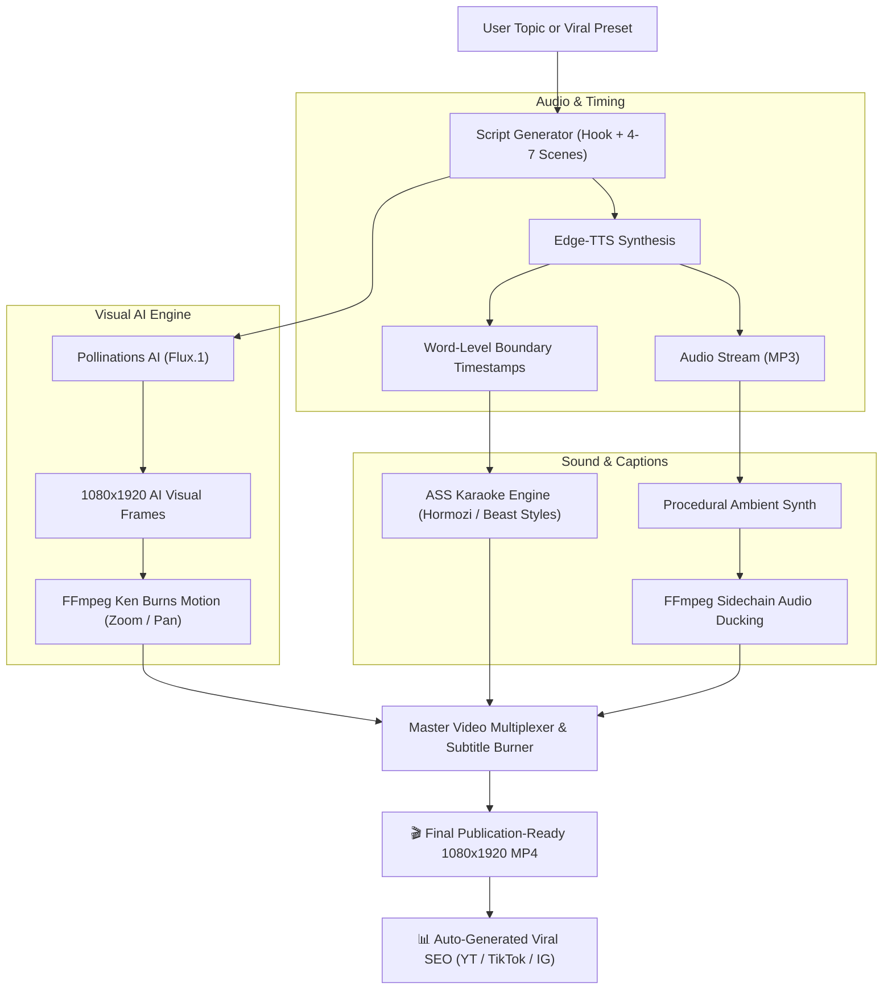

# ⚡ Faceless Shorts: 100% Free AI Faceless Video Generator

<p align="center">
  
  
  
  
  
  
</p>

> **An autonomous Agent Skill and Python engine that generates viral, vertical 9:16 faceless videos for YouTube Shorts, Instagram Reels, and TikTok with ZERO API costs, zero subscriptions, and no credit card required.**

---

## 🌟 Why Faceless Shorts?

Most automated video tools charge monthly SaaS subscriptions (\$30–\$100/mo) or demand paid OpenAI, ElevenLabs, and Midjourney API keys. 

**Faceless Shorts is engineered from the ground up to be 100% free forever** by chaining state-of-the-art open APIs, neural speech synthesis, and local media processing:

| Pipeline Stage | Paid Industry Standard | **Faceless Shorts (100% Free)** | Cost |
| :--- | :--- | :--- | :--- |
| **Scriptwriting** | ChatGPT Plus (\$20/mo) | **Built-in Viral Retention Formulas & LLM Skill** | **\$0.00** |
| **Voiceover** | ElevenLabs (\$22–\$99/mo) | **Microsoft Edge-TTS (300+ Neural Studio Voices)** | **\$0.00** |
| **Word Timestamps**| Whisper API (\$0.006/min) | **Native Edge-TTS WordBoundary Events** | **\$0.00** |
| **AI Visuals** | Midjourney / DALL-E (\$30/mo) | **Pollinations AI (Flux.1 / SDXL 9:16 Engine)** | **\$0.00** |
| **Captions** | CapCut Pro / AutoSubtitle | **Karaoke ASS Subtitles (Hormozi / Beast / Neon)** | **\$0.00** |
| **Sound Design** | Epidemic Sound (\$15/mo) | **Procedural Tension Synth & Sidechain Ducking** | **\$0.00** |
| **Rendering** | Cloud Render Farms | **Hardware-Accelerated FFmpeg Pipeline** | **\$0.00** |
| **Total Monthly Cost** | **\$90 – \$250 / month** | **Completely Free Forever** | **\$0.00** |

---

## 🏗️ Architecture & Pipeline Flow



---

## 🚀 Quickstart Installation

### Prerequisites
1. **Python 3.9+**
2. **FFmpeg** (Ensure FFmpeg is installed on your system PATH):
   * **macOS**: `brew install ffmpeg-full` (or `brew install ffmpeg`)
   * **Ubuntu / Debian**: `sudo apt update && sudo apt install ffmpeg`
   * **Windows**: `winget install Gyan.FFmpeg` or download from [ffmpeg.org](https://ffmpeg.org)

### 1. Clone & Install
```bash
git clone https://github.com/su6osec/faceless-shorts.git
cd faceless-shorts
pip install -r requirements.txt
```

---

## 🎬 How to Use

### 1. Generate via Built-in Viral Presets (One-Liner)

Generate a viral **Dark Psychology** short:
```bash
python -m faceless_shorts generate --niche dark_psychology --voice christopher --style hormozi
```

Generate an ancient **Stoicism** short:
```bash
python -m faceless_shorts generate --niche stoicism --voice ryan --style minimalist_gold
```

Generate a **Mind-Blowing Space Facts** short:
```bash
python -m faceless_shorts generate --niche mind_blowing_facts --voice guy --style neon_cyberpunk
```

### 2. Fast Offline Mode (Zero Internet / Instant Render)
If you are on an airplane, have slow internet, or want to test rendering in under 5 seconds, use `--offline` to generate sleek abstract ambient visuals locally:
```bash
python -m faceless_shorts generate --niche stoicism --offline --output output/quick_test.mp4
```

### 3. Generate from Custom JSON Script
You can supply your own scene definitions:
```bash
python -m faceless_shorts generate --script-json presets/finance_hustle.json --output output/finance.mp4
```

### 4. Batch Production (Produce a Week of Content in Minutes)
Automatically generate 5 shorts across rotating niches with matching SEO packs:
```bash
python scripts/batch_generate.py --count 5 --output-dir weekly_shorts
```

---

## 🎨 Viral Subtitle Styles

View all available styles directly in terminal: `python -m faceless_shorts styles`

| Style Key | Aesthetic | Active Word Highlight | Inactive Color | Outline | Words/Screen |
| :--- | :--- | :--- | :--- | :--- | :---: |
| **`hormozi`** | Alex Hormozi Classic | Bright Neon Yellow (`#002BF7`) | Solid White | 6px Black | 3 |
| **`neon_cyberpunk`** | Electric Sci-Fi | Cyan Glow (`#00FFFF00`) | Lime/White | 5px Purple | 3 |
| **`crimson_alert`** | Horror / Crime Alert | Vivid Blood Red (`#001111FF`) | Stark White | 6px Black | 2 |
| **`beast_pop`** | MrBeast Pop | Toxic Lime Green (`#0000FF00`) | Bright Yellow | 7px Black | 3 |
| **`minimalist_gold`** | Luxury / Meditative | Champagne Gold (`#0050C8E8`)| Silver Gray | 4px Dark | 4 |

---

## 🎙️ Curated Edge-TTS Free Neural Voices

Audition voices in terminal: `python -m faceless_shorts voices`

| Shortcut | Voice ID | Gender | Tone & Vibe | Recommended Niches |
| :--- | :--- | :--- | :--- | :--- |
| **`christopher`** | `en-US-ChristopherNeural` | Male | Deep, mysterious, intense | Dark Psychology, Stoicism, Crime |
| **`guy`** | `en-US-GuyNeural` | Male | Energetic, conversational | Facts, Tech, Lifehacks, Trivia |
| **`aria`** | `en-US-AriaNeural` | Female | Clear, articulate, credible | History, Documentaries, Science |
| **`jenny`** | `en-US-JennyNeural` | Female | Youthful, natural, friendly | Lifestyle, Wholesome, Storytelling |
| **`eric`** | `en-US-EricNeural` | Male | Confident, direct, punchy | Motivation, Finance, Hustle |
| **`ryan`** | `en-GB-RyanNeural` | Male | Sophisticated British accent | Philosophy, Literature, Space |
| **`sonia`** | `en-GB-SoniaNeural` | Female | Dramatic British female | True Crime, Creepypasta, Mystery |
| **`madhur`** | `hi-IN-MadhurNeural` | Male | Indian English / Hindi dynamic | Facts, Motivation, Desi Trivia |
| **`swara`** | `hi-IN-SwaraNeural` | Female | Indian English / Hindi smooth | Storytelling, Culture, Mythos |
| **`alvaro`** | `es-ES-AlvaroNeural` | Male | Spanish native, expressive | Spanish Shorts, Curiosidades |

*To audition audio samples of all voices on your machine, run `python scripts/preview_voices.py`.*

---

## 🤖 Using as an Agent Skill (Claude, Gemini, Antigravity, OpenCode)

This repository adheres to the **Agent Skills standard**, making it natively discoverable by AI assistants.

### In Google Antigravity & Gemini CLI
The skill is registered under `.agents/skills/faceless-shorts/SKILL.md`. Simply prompt the agent:
> *"Create a 45-second dark psychology short about why people ghost others using the Hormozi subtitle style and Christopher's voice."*

The agent reads `SKILL.md`, formulates the script, generates the visual prompts, executes the engine, and returns the finished video with SEO tags.

### In Claude Code
Claude Code discovers the root `SKILL.md` or `.claude/skills/`. Prompt Claude:
> *"Use the faceless-shorts skill to batch generate 3 shorts about space mysteries."*

### In OpenCode / Cursor / Windsurf
The instructions are codified in `AGENTS.md` and `GEMINI.md`. Any agent can execute commands autonomously.

---

## 📁 Repository Structure

```text
faceless-shorts/
├── .agents/
│   └── skills/
│       └── faceless-shorts/
│           ├── SKILL.md                          # Main Agent Skill instruction definition
│           └── references/                       # On-demand knowledge base
│               ├── viral_hooks_blueprint.md       # 20+ viral hook formulas & pacing
│               ├── voice_catalog.md              # 300+ Edge-TTS voice list
│               ├── subtitle_styles.md            # ASS color codes & animation specs
│               ├── prompt_engineering_visuals.md # Flux.1 / SDXL 9:16 visual prompts
│               └── free_resources.md             # Free APIs and asset sources
├── faceless_shorts/                              # Core Python Engine
│   ├── __init__.py
│   ├── cli.py                                    # Rich terminal interface
│   ├── config.py                                 # Presets, voice catalogs, style hexes
│   ├── script_generator.py                       # Scene chunking & hook builder
│   ├── tts_engine.py                             # Edge-TTS & word timestamp extractor
│   ├── visuals.py                                # Pollinations Flux AI & Ken Burns motion
│   ├── subtitles.py                              # ASS karaoke generator with emojis
│   ├── audio.py                                  # Procedural tension synth & ducking
│   ├── renderer.py                               # FFmpeg master assembler
│   └── metadata.py                               # Viral SEO, titles, descriptions & tags
├── presets/                                      # Ready-to-render JSON scripts
│   ├── dark_psychology.json
│   ├── stoicism.json
│   ├── mind_blowing_facts.json
│   ├── horror_mystery.json
│   └── finance_hustle.json
├── scripts/
│   ├── generate_short.py                         # Single execution runner
│   ├── batch_generate.py                         # Multi-video scheduler
│   └── preview_voices.py                         # Voice audition generator
├── tests/                                        # Pytest / Unittest suite
├── pyproject.toml                                # Package build config
├── requirements.txt                              # Lightweight dependencies
├── LICENSE                                       # MIT License (su6osec)
└── README.md
```

---

## 📤 Posting to GitHub (`su6osec`)

To publish this project to your GitHub profile:

```bash
# 1. Initialize git repository
git init

# 2. Add all files
git add .

# 3. Create your initial release commit
git commit -m "feat: initial release of 100% free AI faceless shorts generator"

# 4. Set branch to main
git branch -M main

# 5. Link your GitHub remote repository (replace with your repo URL)
git remote add origin https://github.com/su6osec/faceless-shorts.git

# 6. Push to GitHub!
git push -u origin main
```

---

## 📜 License

Distributed under the **MIT License**. Created with ❤️ by **[su6osec](https://github.com/su6osec)**. Free for commercial and non-commercial use on YouTube, TikTok, Instagram, or any other platform.
