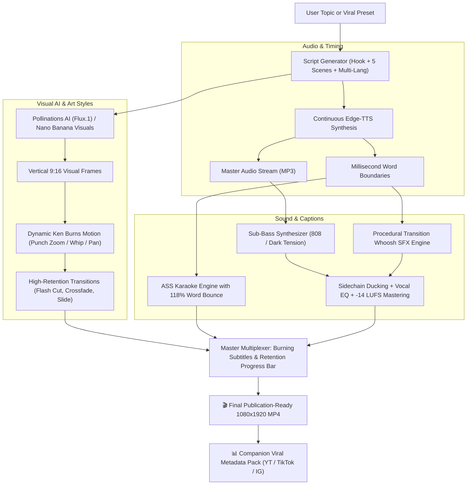

# ⚡ Faceless Shorts: 100% Free AI Faceless Video Generator

<p align="center">
  
  
  
  
  
  
</p>

> **An autonomous Agent Skill and Python engine that generates viral, vertical 9:16 faceless videos for YouTube Shorts, Instagram Reels, and TikTok with ZERO API costs, zero subscriptions, and no credit card required.**

---

## 🌟 What Makes This Special?

1. **100% Zero-Cost Stack**: Microsoft Edge-TTS neural audio + Pollinations AI (Flux.1) + FFmpeg. No subscriptions, no API keys needed.
2. **Multi-Language Support (`--language` / `-l`)**:
   * Produce shorts in **11+ languages**: English (`en`), Hindi (`hi`), Spanish (`es`), French (`fr`), German (`de`), Portuguese (`pt`), Japanese (`ja`), Arabic (`ar`), Russian (`ru`), Italian (`it`), Indonesian (`id`).
   * Automatically pairs native neural voices and typography fonts (`Kohinoor Devanagari`, `Hiragino Sans`, `Geeza Pro`, `Arial Black`).
3. **High-Retention Scene Transitions (`--transition` / `-tr`)**:
   * **`flash`**: White Flash Cut (#1 viral transition on TikTok/Shorts).
   * **`crossfade`**: Cinematic 0.25s dissolve between scenes.
   * **`slide`**: Kinetic whip slide left.
   * **`wipe`**: Graphic wipe transition.
   * **`cut`**: Direct hard cut.
4. **Motion Graphics & Retention Progress Bar**:
   * Glowing animated bottom progress bar to maximize viewer retention and loop completions.
   * Dynamic Ken Burns camera motion (`punch_zoom_in`, `dramatic_zoom_out`, `pan_left`, `pan_right`, `vertigo_shake`, `whip_zoom`).
5. **Studio Audio Base & Sound Design**:
   * Deep sub-bass presets: **`sub_bass_808`** (45Hz sub punch), `dark_tension`, `cinematic_pulse`, `curiosity_ambient`.
   * Procedural transition whoosh SFX synced frame-accurately to scene cuts.
   * Vocal presence EQ (cuts rumble at 75Hz + 3.5kHz clarity boost).
   * Dynamic sidechain audio ducking under speech.
   * Master loudness normalization targeting **-14 LUFS** (EBU R128 standard).
6. **Universal Topic Builder**:
   * Pre-built viral presets (`fitness`, `dark_psychology`, `stoicism`, `motivation`, `finance_hustle`, `ai_tech`, `horror_mystery`, `mind_blowing_facts`).
   * **Dynamic AI Script Generator for ANY custom topic or language on the fly** (`--topic "boxing psychology"`).
7. **Trendy Social Media Video Styles (`--art-style`)**:
   * **`sketch`**: Detailed black & white manga graphic novel line art with heavy ink crosshatching.
   * **`old_style`**: Vintage 1970s/80s analog 35mm film aesthetic with warm Kodachrome curves, grain, and vignette.
   * **`paper_craft`**: Textured torn-paper collage scrapbook aesthetic (the viral Vox / MagnatesMedia style).
   * **`cyberpunk_glitch`**: Dark neon cyan/magenta rim lighting with deep contrast.
   * **`cinematic_noir`**: Deep chiaroscuro shadows with warm amber rim light (David Fincher look).
   * **`hyperreal`**: Photorealistic 8k octane render with cinematic depth of field.
8. **Premium Typography & 118% Word Bounce**:
   * Heavy fonts (`Arial Black`, `Impact`, `Kohinoor Devanagari`) with thick 7px-8px black outlines.
   * Spoken words dynamically pop with a 118% scale bounce animation in real time.
9. **Frame-Accurate Synchronization**:
   * Continuous stream speech synthesis eliminates MP3 frame padding drift. Visual cuts, transitions, whooshes, and karaoke subtitles match speech down to the millisecond.

---

## 🏗️ Architecture & Pipeline Flow



---

## 🚀 Quickstart Installation

### Prerequisites
1. **Python 3.9+**
2. **FFmpeg** (Ensure FFmpeg is installed on your system PATH):
   * **macOS**: `brew install ffmpeg-full` (or `brew install ffmpeg`)
   * **Ubuntu / Debian**: `sudo apt update && sudo apt install ffmpeg`
   * **Windows**: `winget install Gyan.FFmpeg` or download from [ffmpeg.org](https://ffmpeg.org)

### 1. Clone & Install
```bash
git clone https://github.com/su6osec/faceless-shorts.git
cd faceless-shorts
pip install -r requirements.txt
```

---

## 🎬 How to Use

### 1. High-Retention Fitness Short (White Flash + Sub-Bass 808)
```bash
python -m faceless_shorts generate --niche fitness --transition flash --music sub_bass_808 --style hormozi
```

### 2. Hindi Short with Native Voice & Devanagari Subtitles
```bash
python -m faceless_shorts generate --topic "कसरत" --language hi --transition flash --style hormozi
```

### 3. Spanish Dark Psychology Short (Manga Sketch Style)
```bash
python -m faceless_shorts generate --topic "trucos psicologicos" --language es --art-style sketch --transition slide
```

### 4. Vintage 35mm Film Stoicism Short
```bash
python -m faceless_shorts generate --niche stoicism --art-style old_style --transition crossfade --style minimalist_gold
```

### 5. Instant Offline Test (Renders in ~10 seconds)
```bash
python -m faceless_shorts generate --niche stoicism --offline --output output/offline_stoic.mp4
```

### 6. Batch Production (Produce a Week of Content in Minutes)
```bash
python scripts/batch_generate.py --count 5 --output-dir weekly_shorts
```

---

## 🌐 Supported Languages & Voices

View all languages: `python -m faceless_shorts languages`

| Code | Language | Default Voice | Recommended Subtitle Font |
| :--- | :--- | :--- | :--- |
| **`en`** | English | `christopher` | `Arial Black` |
| **`hi`** | Hindi (हिंदी) | `madhur` | `Kohinoor Devanagari` |
| **`es`** | Spanish (Español) | `alvaro` | `Arial Black` |
| **`fr`** | French (Français) | `henri` | `Arial Black` |
| **`de`** | German (Deutsch) | `conrad` | `Arial Black` |
| **`pt`** | Portuguese (Português) | `antonio` | `Arial Black` |
| **`ja`** | Japanese (日本語) | `keita` | `Hiragino Sans` |
| **`ar`** | Arabic (العربية) | `hamed` | `Geeza Pro` |
| **`ru`** | Russian (Русский) | `dmitry` | `Arial Black` |
| **`it`** | Italian (Italiano) | `diego` | `Arial Black` |
| **`id`** | Indonesian (Bahasa) | `ardi` | `Arial Black` |

---

## 🎬 High-Retention Scene Transitions

View transitions: `python -m faceless_shorts transitions`

| Key | Transition Name | Duration | Description |
| :--- | :--- | :---: | :--- |
| **`flash`** | White Flash Cut | 0.22s | #1 viral retention transition on TikTok and YouTube Shorts |
| **`crossfade`** | Cinematic Crossfade | 0.25s | Smooth cinematic dissolve between scenes |
| **`slide`** | Dynamic Slide Left | 0.22s | Fast kinetic whip slide transition |
| **`wipe`** | Graphic Wipe Left | 0.22s | Clean graphic wipe across the canvas |
| **`cut`** | Hard Cut | 0ms | Instant cut between scenes |

---

## 🎨 Trendy Video Editing & Art Styles

View styles: `python -m faceless_shorts art-styles`

| Art Style Key | Aesthetic Description | Visual Grade |
| :--- | :--- | :--- |
| **`hyperreal`** | Photorealistic 8k octane render with volumetric studio lighting | Clean vivid studio contrast |
| **`sketch`** | Detailed black & white manga graphic novel with heavy ink cross-hatching | Grayscale, high-contrast ink lines |
| **`old_style`** | Vintage 1970s/80s analog 35mm film with grain, Kodachrome curves & vignette | Warm nostalgic retro tones |
| **`paper_craft`** | Textured torn-paper collage scrapbook aesthetic (Vox / MagnatesMedia style) | Matte paper texture & papercraft |
| **`cyberpunk_glitch`** | Dark futuristic neon cyan/magenta rim lighting with deep shadows | Saturated neon glow & rim light |
| **`cinematic_noir`** | Moody chiaroscuro shadows with warm amber rim light (David Fincher look) | Deep blacks, high contrast |

---

## 📝 Viral Subtitle Styles (With 118% Word Bounce)

View subtitle styles: `python -m faceless_shorts styles`

| Style Key | Font | Active Highlight | Inactive Color | Outline | Words/Screen |
| :--- | :--- | :--- | :--- | :---: | :---: |
| **`hormozi`** | Arial Black | Bright Neon Yellow (`#002BF7`) | Solid White | 7px Black | 3 |
| **`beast_pop`** | Impact | Toxic Lime Green (`#0000FF00`) | Bright Yellow | 8px Black | 3 |
| **`neon_cyberpunk`** | Arial Black | Electric Cyan (`#00FFFF00`) | Solid White | 6px Purple | 3 |
| **`crimson_alert`** | Arial Black | Blood Crimson Red (`#001111FF`)| Stark White | 7px Black | 2 |
| **`sketch_comic`** | Impact | Warm Amber Gold (`#0000D4FF`) | Solid White | 8px Black | 3 |
| **`minimalist_gold`** | Helvetica Neue | Champagne Gold (`#0050C8E8`)| Silver Gray | 4px Dark | 4 |

---

## 🤖 Using as an Agent Skill (Claude, Gemini, Antigravity, OpenCode)

This repository adheres to the **Agent Skills standard**, making it natively discoverable by AI assistants.

* **In Google Antigravity & Gemini CLI**: The skill is mounted at `.agents/skills/faceless-shorts/SKILL.md`. Simply prompt:
  > *"Create a fitness short in Hindi with white flash transitions and sub-bass 808 audio."*
* **In Claude Code**: Claude discovers `SKILL.md`. Prompt:
  > *"Use faceless-shorts to create 3 Spanish shorts on stoicism with sketch manga visuals."*
* **In OpenCode / Cursor / Windsurf**: Codified in `AGENTS.md` and `GEMINI.md`.

---

## 📤 Posting to GitHub (`su6osec`)

To publish this project to your GitHub:

```bash
git add .
git commit -m "feat: add high-retention transitions (flash cut, crossfade, slide), retention progress bar, sub-bass 808 & transition whoosh SFX, and 11-language support"
git push -u origin main
```

---

## 📜 License

Distributed under the **MIT License**. Created with ❤️ by **[su6osec](https://github.com/su6osec)**.
