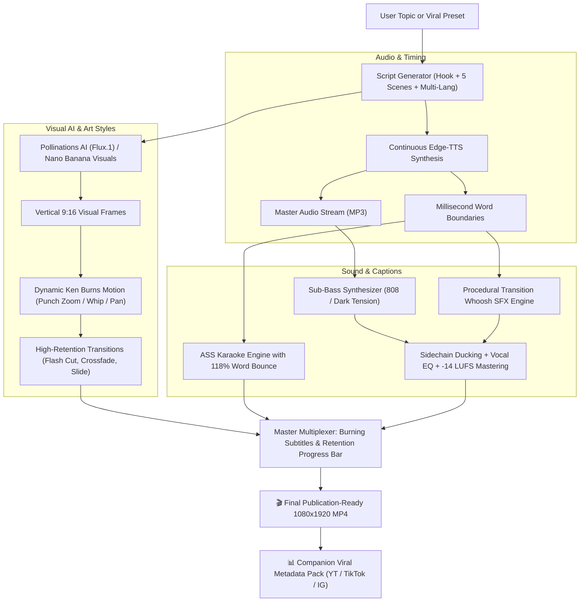

# ⚡ Faceless Shorts: 100% Free AI Faceless Video Generator

<p align="center">
  
  
  
  
  
  
</p>

> **An autonomous Agent Skill and Python engine that generates viral, vertical 9:16 faceless videos for YouTube Shorts, Instagram Reels, and TikTok with ZERO API costs, zero subscriptions, and no credit card required.**

---

## 🌟 What Makes This Special?

1. **100% Zero-Cost Stack**: Microsoft Edge-TTS neural audio + Pollinations AI (Flux.1) or local ComfyUI + FFmpeg + Pillow. No subscriptions, no API keys needed.
2. **45 Three-Stage Art Styles (`--art-style`)**: every style is built from an AI prompt suffix → offline PIL transform (pixel art, chalkboard, glow sketch, halftone, flat vector, minimal line, LEGO studs, blueprint, watercolor...) → FFmpeg grade. Includes `pixel_art`, `ps2_style`, `comic_art`, `cgi_motion`, `lego`, `explainer_3d`, `vaporwave`, `synthwave`, `anime`, `oil_painting` and dozens more across 6 categories.
3. **Premium Post-FX Grades (`--effects`)**: 15 compositing effects + 6 one-command packs — `cinematic` (bloom + halation + teal-orange + grain + vignette), `premium`, `dreamy`, `retro`. Natron-style multi-pass graphs rendered in FFmpeg.
4. **5 Quality Profiles (`--quality`)**: `draft` → `social` → `hd` → `cinematic` (60fps) → `ultra` (1440x2560 @60fps), plus `--fps`, `--crf`, `--encoder-preset` overrides. Broadcast-standard limited-range color with `+faststart` for instant social upload.
5. **17 High-Retention Scene Transitions (`--transition`)**: white flash cut, impact zoom, dream dissolve, pixel mosaic, whip blur, radial, iris circle, fade-to-black, diagonal slice, glitch wind...
6. **10 Ken Burns Camera Moves**: punch zoom, whip zoom, tracking pans, vertigo shake, crane rise, orbital sway, heartbeat pulse, shockwave pull-back.
7. **Multi-Language Support (`--language` / `-l`)**:
   * Produce shorts in **11+ languages**: English (`en`), Hindi (`hi`), Spanish (`es`), French (`fr`), German (`de`), Portuguese (`pt`), Japanese (`ja`), Arabic (`ar`), Russian (`ru`), Italian (`it`), Indonesian (`id`).
   * Automatically pairs native neural voices and typography fonts (`Kohinoor Devanagari`, `Hiragino Sans`, `Geeza Pro`, `Arial Black`).
8. **Motion Graphics & Retention Progress Bar**:
   * Glowing animated bottom progress bar to maximize viewer retention and loop completions.
   * Dynamic Ken Burns camera motion (`punch_zoom_in`, `dramatic_zoom_out`, `pan_left`, `pan_right`, `vertigo_shake`, `whip_zoom`, `rise_up`, `orbit_sway`, `pulse_heartbeat`, `shockwave_out`).
9. **Studio Audio Base & Sound Design**:
   * Deep sub-bass presets: **`sub_bass_808`** (45Hz sub punch), `dark_tension`, `cinematic_pulse`, `curiosity_ambient`.
   * Procedural transition whoosh SFX synced frame-accurately to scene cuts.
   * Vocal presence EQ (cuts rumble at 75Hz + 3.5kHz clarity boost).
   * Dynamic sidechain audio ducking under speech.
   * Master loudness normalization targeting **-14 LUFS** (EBU R128 standard).
10. **Universal Topic Builder & Script Intelligence**:
   * Pre-built viral presets (`fitness`, `dark_psychology`, `stoicism`, `motivation`, `finance_hustle`, `ai_tech`, `horror_mystery`, `mind_blowing_facts`, `blackhole`).
   * **Curated knowledge packs** with factual scene scripts (brain, sleep, ocean, Mars).
   * **Optional free local LLM** (Ollama / OpenAI-compatible) for fresh scripts on any topic.
   * **Dynamic AI Script Generator for ANY custom topic or language on the fly** (`--topic "boxing psychology"`).
11. **Free Tool Integrations (`doctor`, `transcribe`)** — all optional and auto-detected:
   * **Whisper STT** via FFmpeg's built-in whisper.cpp filter → 100% offline SRT/JSON transcription.
   * **ComfyUI** local GPU image generation (`--engine comfyui`), **yt-dlp** B-roll sourcing, **Ollama** scriptwriting, **Pexels/Pixabay** free stock.
12. **Premium Typography & 118% Word Bounce**:
   * 13 subtitle styles (Arial Black, Impact, Chalkboard SE, Georgia, neon glow blur, phosphor green arcade...) with thick 7px-8px black outlines.
   * Spoken words dynamically pop with a 118% scale bounce animation in real time.
13. **Frame-Accurate Synchronization**:
   * Continuous stream speech synthesis eliminates MP3 frame padding drift. Visual cuts, transitions, whooshes, and karaoke subtitles match speech down to the millisecond.

---

## 🏗️ Architecture & Pipeline Flow



---

## 🚀 Quickstart Installation

### Prerequisites
1. **Python 3.9+**
2. **FFmpeg** (Ensure FFmpeg is installed on your system PATH):
   * **macOS**: `brew install ffmpeg-full` (or `brew install ffmpeg`)
   * **Ubuntu / Debian**: `sudo apt update && sudo apt install ffmpeg`
   * **Windows**: `winget install Gyan.FFmpeg` or download from [ffmpeg.org](https://ffmpeg.org)

### 1. Clone & Install
```bash
git clone https://github.com/su6osec/faceless-shorts.git
cd faceless-shorts
pip install -r requirements.txt
```

---

## 🎬 How to Use

### 1. High-Retention Fitness Short (White Flash + Sub-Bass 808)
```bash
python -m faceless_shorts generate --niche fitness --transition flash --music sub_bass_808 --style hormozi
```

### 2. Hindi Short with Native Voice & Devanagari Subtitles
```bash
python -m faceless_shorts generate --topic "कसरत" --language hi --transition flash --style hormozi
```

### 3. Spanish Dark Psychology Short (Manga Sketch Style)
```bash
python -m faceless_shorts generate --topic "trucos psicologicos" --language es --art-style sketch --transition slide
```

### 4. Vintage 35mm Film Stoicism Short
```bash
python -m faceless_shorts generate --niche stoicism --art-style old_style --transition crossfade --style minimalist_gold
```

### 5. Instant Offline Test (Renders in ~10 seconds)
```bash
python -m faceless_shorts generate --niche stoicism --offline --output output/offline_stoic.mp4
```

### 6. Premium Demo-Style Render (Cinematic Grade + Impact Zoom + HD)
```bash
python -m faceless_shorts generate --topic "black hole" -q hd -fx cinematic -tr zoom -s neon_glow --output output/black_hole_demo.mp4
```

### 7. Retro Pixel-Art Short (Offline, Renders in Seconds)
```bash
python -m faceless_shorts generate --niche mind_blowing_facts -a pixel_art -tr pixelize -fx retro --offline
```

### 8. Batch Production (Produce a Week of Content in Minutes)
```bash
python scripts/batch_generate.py --count 5 --output-dir weekly_shorts
```

### 🔍 Free Tool Health Check
```bash
python -m faceless_shorts doctor   # detects FFmpeg, whisper.cpp, yt-dlp, ComfyUI, Ollama, Pexels/Pixabay keys
```

---

## 🌐 Supported Languages & Voices

View all languages: `python -m faceless_shorts languages`

| Code | Language | Default Voice | Recommended Subtitle Font |
| :--- | :--- | :--- | :--- |
| **`en`** | English | `christopher` | `Arial Black` |
| **`hi`** | Hindi (हिंदी) | `madhur` | `Kohinoor Devanagari` |
| **`es`** | Spanish (Español) | `alvaro` | `Arial Black` |
| **`fr`** | French (Français) | `henri` | `Arial Black` |
| **`de`** | German (Deutsch) | `conrad` | `Arial Black` |
| **`pt`** | Portuguese (Português) | `antonio` | `Arial Black` |
| **`ja`** | Japanese (日本語) | `keita` | `Hiragino Sans` |
| **`ar`** | Arabic (العربية) | `hamed` | `Geeza Pro` |
| **`ru`** | Russian (Русский) | `dmitry` | `Arial Black` |
| **`it`** | Italian (Italiano) | `diego` | `Arial Black` |
| **`id`** | Indonesian (Bahasa) | `ardi` | `Arial Black` |

---

## 🎬 High-Retention Scene Transitions

View transitions: `python -m faceless_shorts transitions`

| Key | Transition Name | FFmpeg Technique | Description |
| :--- | :--- | :--- | :--- |
| **`flash`** | White Flash Cut | `xfade=fadewhite` | #1 viral retention transition on TikTok and YouTube Shorts |
| **`crossfade`** | Cinematic Crossfade | `xfade=fade` | Smooth 0.25s cinematic dissolve |
| **`slide`** | Dynamic Slide Left | `xfade=slideleft` | Fast kinetic whip slide |
| **`wipe`** | Graphic Wipe Left | `xfade=wipeleft` | Clean graphic wipe across the canvas |
| **`cut`** | Hard Cut | — | Instant 0ms cut between scenes |
| **`zoom`** | Impact Zoom-In | `xfade=zoomin` | Hard punch zoom-in (MrBeast scene impact) |
| **`dissolve`** | Dream Dissolve | `xfade=dissolve` | Frame-scrambling flashback dissolve |
| **`pixelize`** | Pixel Mosaic | `xfade=pixelize` | 8-bit mosaic (pairs with pixel_art / PS2) |
| **`radial`** | Radial Burst | `xfade=radial` | Circular reveal sweeping from center |
| **`circle`** | Iris Circle Open | `xfade=circleopen` | Camera-iris retro cartoon reveal |
| **`blur`** | Whip Blur | `xfade=hblur` | Directional motion-blur whip pan |
| **`black`** | Fade To Black | `xfade=fadeblack` | Dramatic beat-drop cut |
| **`smooth`** | Smooth Glide | `xfade=smoothleft` | Eased premium documentary slide |
| **`diag`** | Diagonal Slice | `xfade=diagbl` | Comic-panel slice (pairs with comic_art) |
| **`squeeze`** | Elastic Squeeze | `xfade=squeezev` | Vertical elastic squeeze (toy/playful) |
| **`wind`** | Glitch Wind | `xfade=hlwind` | Wind-shear glitch wipe (cyberpunk/VHS) |
| **`gray`** | Bleach Fade | `xfade=fadegrays` | Desaturating emotional fade-to-gray |

All 17 keys map to real FFmpeg `xfade` transition names (FFmpeg 9 ships 57) — every mapping is verified by unit test.

---

## 🎨 Trendy Video Editing & Art Styles

View styles: `python -m faceless_shorts art-styles` (45 styles in 6 categories)

Every style runs three stages: **AI prompt suffix** → **offline PIL transform** (works with `--offline` too) → **FFmpeg grade** during motion render.

| Category | Style Keys |
| :--- | :--- |
| 🎬 **Cinematic & Photoreal** (9) | `hyperreal` `cinematic_noir` `old_style` `cyberpunk_glitch` `teal_orange` `anamorphic_epic` `documentary` `noir_bw` `neon_noir` |
| 🎨 **Illustration & Art** (13) | `sketch` `chalkboard` `glow_sketch` `comic_art` `flat_vector` `minimal_line` `watercolor` `oil_painting` `pop_art` `blueprint` `anime` `storybook` `ink_wash` |
| 🕹️ **Retro & Games** (8) | `pixel_art` `ps2_style` `crt_retro` `vaporwave` `low_poly` `game_boy` `voxel_art` `lego` |
| 🧊 **3D & Motion Graphics** (5) | `cgi_motion` `explainer_3d` `isometric_3d` `claymation` `product_render` |
| 📰 **Texture & Craft** (6) | `paper_craft` `riso` `halftone_news` `steampunk` `stained_glass` `ukiyo_e` |
| ⚡ **Neon & Future** (4) | `neon_glow` `synthwave` `hologram` `matrix_code` |

---

## 📝 Viral Subtitle Styles (With 118% Word Bounce)

View subtitle styles: `python -m faceless_shorts styles`

| Style Key | Font | Active Highlight | Inactive Color | Outline | Words/Screen |
| :--- | :--- | :--- | :--- | :---: | :---: |
| **`hormozi`** | Arial Black | Bright Neon Yellow (`#002BF7`) | Solid White | 7px Black | 3 |
| **`beast_pop`** | Impact | Toxic Lime Green (`#0000FF00`) | Bright Yellow | 8px Black | 3 |
| **`neon_cyberpunk`** | Arial Black | Electric Cyan (`#00FFFF00`) | Solid White | 6px Purple | 3 |
| **`crimson_alert`** | Arial Black | Blood Crimson Red (`#001111FF`)| Stark White | 7px Black | 2 |
| **`sketch_comic`** | Impact | Warm Amber Gold (`#0000D4FF`) | Solid White | 8px Black | 3 |
| **`minimalist_gold`** | Helvetica Neue | Champagne Gold (`#0050C8E8`)| Silver Gray | 4px Dark | 4 |
| **`neon_glow`** | Arial Black | Pure Neon Cyan | Solid White | 5px Black + `\blur` halo | 3 |
| **`chalk_classic`** | Chalkboard SE | Chalk Yellow | Chalk White | 6px Slate | 3 |
| **`retro_pop`** | Courier Bold | Hot Pink | Cream White | 7px Black | 3 |
| **`pixel_arcade`** | Press Start 2P | Phosphor Green | Amber | 6px Black | 2 |
| **`luxury_cinema`** | Georgia | Champagne Gold | Warm Ivory | 3px Dark | 4 |
| **`horror_bleed`** | American Typewriter | Blood Crimson | Stark White | 6px Black + glow | 2 |
| **`glow_blur`** | Arial Black | Electric Cyan | Solid White | 5px + 8px neon blur | 3 |

All styles feature 118% active-word bounce, word-level karaoke timing (Edge-TTS native timestamps) and proportional scaling for any canvas size.

---

## 🎚️ Quality Profiles (`-q`)

View profiles: `python -m faceless_shorts quality`

| Profile | Resolution | FPS | CRF | Use Case |
| :--- | :---: | :---: | :---: | :--- |
| **`draft`** | 1080x1920 | 30 | 30 | Fast iteration / previews |
| **`social`** | 1080x1920 | 30 | 23 | Standard TikTok / Reels / Shorts upload |
| **`hd`** | 1080x1920 | 60 | 20 | High-fidelity smooth motion |
| **`cinematic`** | 1440x2560 | 30 | 18 | Film-look premium grade |
| **`ultra`** | 1440x2560 | 60 | 16 | Maximum quality (large file) |

Override any profile with `--fps`, `--crf`, `--encoder-preset`.

---

## 🌈 Premium Post-FX Grades (`-fx`)

View effects: `python -m faceless_shorts effects`

15 multi-pass FFmpeg compositing grades (bloom, halation, chromatic aberration, teal-orange, film grain, vignette, anamorphic streaks):

`cinematic_teal_orange` · `neo_tokyo_night` · `vhs_1987` · `deep_space` · `sunset_bloom` · `night_vision` · `noir_high_contrast` · `polaroid` · `toxic_waste` · `royal_gold` · `ghost_in_shell` · `fire_ember` · `ice_age` · `dream_haze` · `broadcast_clean`

Or chain several at once with a pack: `-fx cinematic` · `-fx premium` · `-fx dreamy` · `-fx retro`

---

## 🛠️ Free Tool Integrations

`python -m faceless_shorts doctor` auto-detects optional free tools — everything works with zero installs, these only unlock more power:

| Tool | Unlocks | Cost |
| :--- | :--- | :--- |
| **whisper.cpp / FFmpeg whisper** | `transcribe` command → local SRT extraction | Free, offline |
| **yt-dlp** | Reference/compilation workflows | Free |
| **ComfyUI** | `--engine comfyui` local Stable Diffusion visuals | Free, offline |
| **Ollama** | Local LLM script generation (no OpenAI key) | Free, offline |
| **Pexels / Pixabay keys** | Stock video/image backgrounds (optional keys) | Free tier |

---

## 🤖 Using as an Agent Skill (Claude, Gemini, Antigravity, OpenCode)

This repository adheres to the **Agent Skills standard**, making it natively discoverable by AI assistants.

* **In Google Antigravity & Gemini CLI**: The skill is mounted at `.agents/skills/faceless-shorts/SKILL.md`. Simply prompt:
  > *"Create a fitness short in Hindi with white flash transitions and sub-bass 808 audio."*
* **In Claude Code**: Claude discovers `SKILL.md`. Prompt:
  > *"Use faceless-shorts to create 3 Spanish shorts on stoicism with sketch manga visuals."*
* **In OpenCode / Cursor / Windsurf**: Codified in `AGENTS.md` and `GEMINI.md`.

---

## 📤 Posting to GitHub (`su6osec`)

To publish this project to your GitHub:

```bash
git add .
git commit -m "feat: add high-retention transitions (flash cut, crossfade, slide), retention progress bar, sub-bass 808 & transition whoosh SFX, and 11-language support"
git push -u origin main
```

---

## 📜 License

Distributed under the **MIT License**. Created with ❤️ by **[su6osec](https://github.com/su6osec)**.
