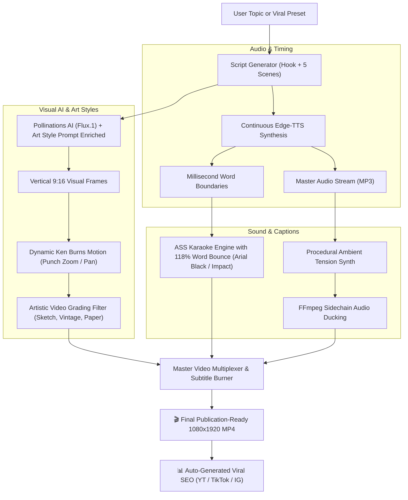

# ⚡ Faceless Shorts: 100% Free AI Faceless Video Generator

<p align="center">
  
  
  
  
  
  
</p>

> **An autonomous Agent Skill and Python engine that generates viral, vertical 9:16 faceless videos for YouTube Shorts, Instagram Reels, and TikTok with ZERO API costs, zero subscriptions, and no credit card required.**

---

## 🌟 What Makes This Special?

1. **100% Zero-Cost Stack**: Microsoft Edge-TTS neural audio + Pollinations AI (Flux.1) + FFmpeg. No subscriptions, no API keys needed.
2. **Universal Topic Builder**: Use pre-built viral presets (`fitness`, `dark_psychology`, `stoicism`, `motivation`, `finance_hustle`, `ai_tech`, `horror_mystery`, `mind_blowing_facts`) **OR pass ANY custom topic** (`--topic "how to beat procrastination"`). The engine will dynamically build a 5-scene viral script with hooks, scene descriptions, and infinite loops on the fly!
3. **Trendy Social Media Video Styles**:
   * **`sketch`**: Detailed black & white manga graphic novel line art with heavy ink crosshatching.
   * **`old_style`**: Vintage 1970s/80s analog 35mm film aesthetic with warm Kodachrome curves, grain, and vignette.
   * **`paper_craft`**: Textured torn-paper collage scrapbook aesthetic (the viral Vox / MagnatesMedia style).
   * **`cyberpunk_glitch`**: Dark neon cyan/magenta rim lighting with deep contrast.
   * **`cinematic_noir`**: Deep chiaroscuro shadows with warm amber rim light (David Fincher look).
   * **`hyperreal`**: Photorealistic 8k octane render with cinematic depth of field.
4. **Premium Typography & 118% Word Bounce**:
   * Heavy fonts (`Arial Black`, `Impact`, `Helvetica Neue`) with thick 7px-8px black outlines.
   * Spoken words dynamically pop with a 118% scale bounce animation in real time.
5. **Frame-Accurate Audio-Visual Sync**:
   * Continuous stream speech synthesis eliminates MP3 frame padding drift. Visual cuts and karaoke subtitles match speech down to the millisecond.

---

## 🏗️ Architecture & Pipeline Flow



---

## 🚀 Quickstart Installation

### Prerequisites
1. **Python 3.9+**
2. **FFmpeg** (Ensure FFmpeg is installed on your system PATH):
   * **macOS**: `brew install ffmpeg-full` (or `brew install ffmpeg`)
   * **Ubuntu / Debian**: `sudo apt update && sudo apt install ffmpeg`
   * **Windows**: `winget install Gyan.FFmpeg` or download from [ffmpeg.org](https://ffmpeg.org)

### 1. Clone & Install
```bash
git clone https://github.com/su6osec/faceless-shorts.git
cd faceless-shorts
pip install -r requirements.txt
```

---

## 🎬 How to Use

### 1. Generate via Built-in Viral Presets

Generate a viral **Fitness** short (Hormozi style):
```bash
python -m faceless_shorts generate --niche fitness --voice christopher --style hormozi
```

Generate a **Manga / Sketch** style Dark Psychology short:
```bash
python -m faceless_shorts generate --niche dark_psychology --art-style sketch --voice christopher --style sketch_comic
```

Generate a **Vintage 35mm Film** Stoicism short:
```bash
python -m faceless_shorts generate --niche stoicism --art-style old_style --voice ryan --style minimalist_gold
```

Generate an **AI & Future Tech** short (Cyberpunk Neon style):
```bash
python -m faceless_shorts generate --niche ai_tech --art-style cyberpunk_glitch --voice guy --style neon_cyberpunk
```

### 2. Build on ANY Custom Topic (No Preset Needed!)
You can pass any topic directly. The engine dynamically writes the script, creates visual prompts, and renders:
```bash
python -m faceless_shorts generate --topic "Cold Showers For Dopamine Reset" --art-style paper_craft --save-preset
```

### 3. Fast Offline Mode (Instant 4-Second Render)
Generate sleek abstract dark ambient visuals locally without internet:
```bash
python -m faceless_shorts generate --niche fitness --offline --output output/quick_test.mp4
```

### 4. Batch Production (Produce a Week of Content in Minutes)
Automatically generate 5 shorts across rotating niches with matching SEO packs:
```bash
python scripts/batch_generate.py --count 5 --output-dir weekly_shorts
```

---

## 🎨 Trendy Video Editing & Art Styles

View all available styles in terminal: `python -m faceless_shorts art-styles`

| Art Style Key | Aesthetic Description | Visual Grade |
| :--- | :--- | :--- |
| **`hyperreal`** | Photorealistic 8k octane render with cinematic depth of field | Clean vivid studio contrast |
| **`sketch`** | Detailed black & white manga graphic novel with heavy ink cross-hatching | Grayscale, high-contrast ink lines |
| **`old_style`** | Vintage 1970s/80s analog 35mm film with grain, Kodachrome curves & vignette | Warm nostalgic retro tones |
| **`paper_craft`** | Textured torn-paper collage scrapbook aesthetic (Vox / MagnatesMedia style) | Matte paper texture & papercraft |
| **`cyberpunk_glitch`** | Dark futuristic neon cyan/magenta rim lighting with deep shadows | Saturated neon glow & chromatic rim |
| **`cinematic_noir`** | Moody chiaroscuro shadows with warm amber rim light (David Fincher look) | Deep blacks, high contrast |

---

## 📝 Viral Subtitle Styles (With 118% Word Bounce)

View all styles in terminal: `python -m faceless_shorts styles`

| Style Key | Font | Active Highlight | Inactive Color | Outline | Words/Screen |
| :--- | :--- | :--- | :--- | :---: | :---: |
| **`hormozi`** | Arial Black | Bright Neon Yellow (`#002BF7`) | Solid White | 7px Black | 3 |
| **`beast_pop`** | Impact | Toxic Lime Green (`#0000FF00`) | Bright Yellow | 8px Black | 3 |
| **`neon_cyberpunk`** | Arial Black | Electric Cyan (`#00FFFF00`) | Solid White | 6px Purple | 3 |
| **`crimson_alert`** | Arial Black | Blood Crimson Red (`#001111FF`)| Stark White | 7px Black | 2 |
| **`sketch_comic`** | Impact | Warm Amber Gold (`#0000D4FF`) | Solid White | 8px Black | 3 |
| **`minimalist_gold`** | Helvetica Neue | Champagne Gold (`#0050C8E8`)| Silver Gray | 4px Dark | 4 |

---

## 🎙️ Curated Edge-TTS Free Neural Voices

Audition voices in terminal: `python -m faceless_shorts voices`

| Shortcut | Voice ID | Gender | Tone & Vibe | Recommended Niches |
| :--- | :--- | :--- | :--- | :--- |
| **`christopher`** | `en-US-ChristopherNeural` | Male | Deep, mysterious, intense | Fitness, Dark Psychology, Stoicism, Crime |
| **`guy`** | `en-US-GuyNeural` | Male | Energetic, conversational | Facts, Tech, Lifehacks, Trivia |
| **`aria`** | `en-US-AriaNeural` | Female | Clear, articulate, credible | History, Documentaries, Science |
| **`jenny`** | `en-US-JennyNeural` | Female | Youthful, natural, friendly | Lifestyle, Wholesome, Storytelling |
| **`eric`** | `en-US-EricNeural` | Male | Confident, direct, punchy | Motivation, Finance, Hustle, Fitness |
| **`ryan`** | `en-GB-RyanNeural` | Male | Sophisticated British accent | Philosophy, Literature, Space |
| **`sonia`** | `en-GB-SoniaNeural` | Female | Dramatic British female | True Crime, Creepypasta, Mystery |
| **`madhur`** | `hi-IN-MadhurNeural` | Male | Indian English / Hindi dynamic | Facts, Motivation, Desi Trivia |

---

## 🤖 Using as an Agent Skill (Claude, Gemini, Antigravity, OpenCode)

This repository adheres to the **Agent Skills standard**, making it natively discoverable by AI assistants.

* **In Google Antigravity & Gemini CLI**: The skill is mounted at `.agents/skills/faceless-shorts/SKILL.md`. Simply prompt:
  > *"Create a fitness short in sketch manga style about why compound lifts build the most muscle."*
* **In Claude Code**: Claude discovers `SKILL.md`. Prompt:
  > *"Use faceless-shorts to batch produce 3 vintage film style shorts about ancient stoicism."*
* **In OpenCode / Cursor / Windsurf**: Codified in `AGENTS.md` and `GEMINI.md`.

---

## 📤 Posting to GitHub (`su6osec`)

To publish this project to your GitHub:

```bash
git add .
git commit -m "feat: add fitness niche, dynamic custom topic builder, artistic video styles (sketch, vintage, papercraft), 118% word bounce and frame-accurate sync"
git push -u origin main
```

---

## 📜 License

Distributed under the **MIT License**. Created with ❤️ by **[su6osec](https://github.com/su6osec)**.
